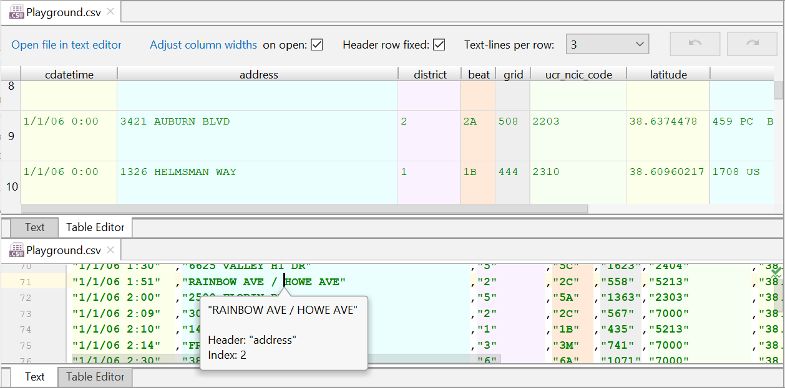
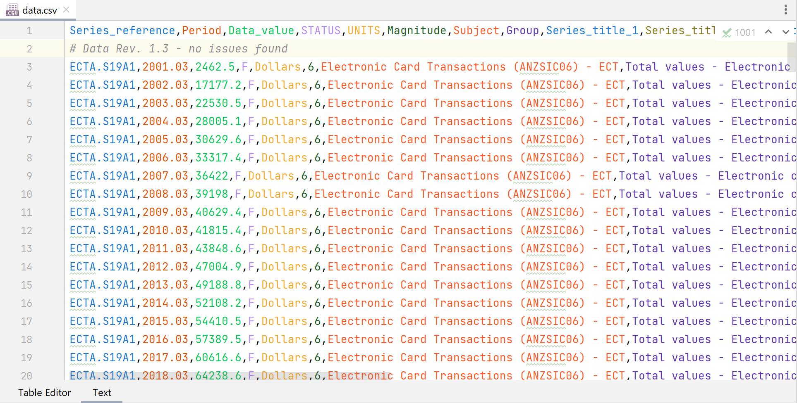
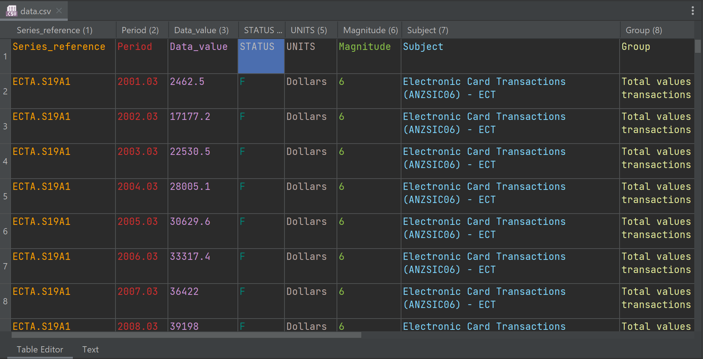
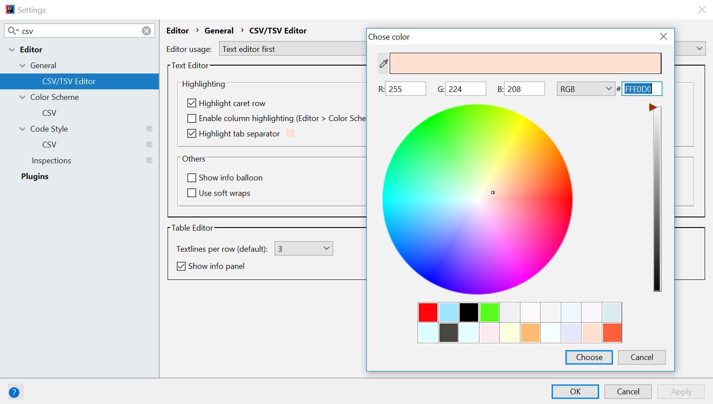
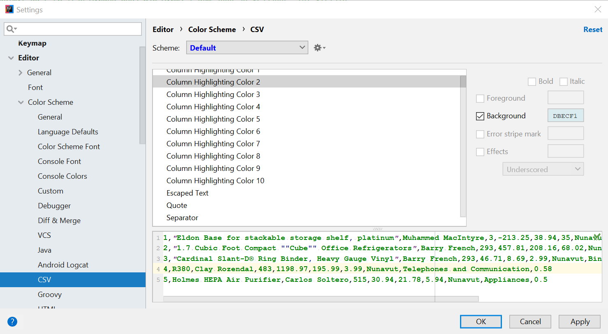
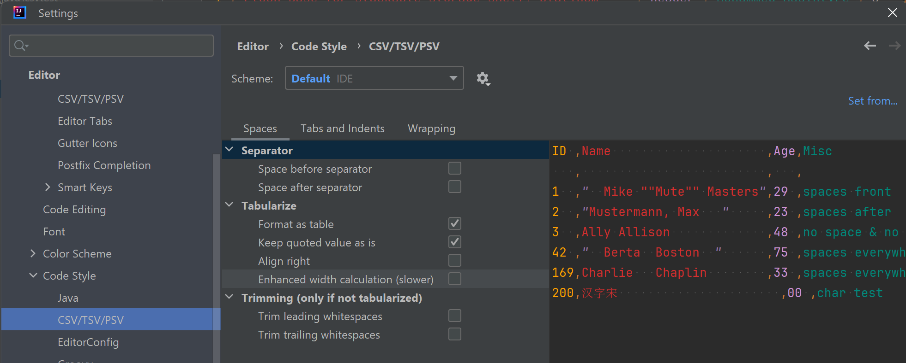
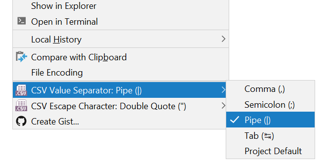

[](https://plugins.jetbrains.com/plugin/10037-csv-plugin)
[](https://github.com/SeeSharpSoft/intellij-csv-validator/actions)
[](https://github.com/SeeSharpSoft/intellij-csv-validator/actions)
[](https://coveralls.io/github/SeeSharpSoft/intellij-csv-validator?branch=main)
[](https://snyk.io/test/github/SeeSharpSoft/intellij-csv-validator?targetFile=build.gradle)
[](https://www.codacy.com/gh/SeeSharpSoft/intellij-csv-validator/dashboard?utm_source=github.com&amp;utm_medium=referral&amp;utm_content=SeeSharpSoft/intellij-csv-validator&amp;utm_campaign=Badge_Grade)

# CSV Editor Plugin for the JetBrains IDE family

Compatible with IntelliJ IDEA and other JetBrains IDEs based on IntelliJ Platform _2024.2 and newer_.

This plugin adds support for CSV (Comma-Separated Values) and related file types to JetBrains IDEs. It provides a text editor and a table editor with syntax validation, highlighting, formatting, inspections, and other familiar IDE features.



## Features

- CSV, TSV, and PSV file detection
- customizable text and table editors
- customizable column coloring (rainbow coloring)
- syntax validation and highlighting
- code formatting
- quick-fix inspections
- intentions (Alt+Enter), such as Quote/Unquote (all) and Shift Column Left/Right
- spell checking for field values
- an optional information tooltip showing the current value, column header, and column number
- comma, semicolon, colon, pipe, tab, and record-separator value separators
- custom value separators
- line comments (# by default, customizable)
- tab-separator highlighting

(see [full changelog](./CHANGELOG.md))

**Note**

Release 4.x focuses on text-editor features, and the text editor is the default editor.
**IntelliJ Platform 2024.2 or newer is required.**

Previous versions, including their README files, can still be downloaded and installed manually (see [Installation](https://github.com/SeeSharpSoft/intellij-csv-validator#installation)).

### Validation

The plugin checks CSV files according to the standard defined in [RFC 4180](https://www.ietf.org/rfc/rfc4180.txt), but it tolerates whitespace around quoted values and accepts most literal text. This makes validation less restrictive and keeps the format flexible.

According to the strict standard, the following snippet is invalid because of the whitespace after each comma. The plugin accepts it:

```
"firstName", "lastName", "birthday"
```
Syntax errors are still detected and can be inspected. If a document contains syntax errors, features such as the table editor, code formatting, or structure view may be unavailable or may work with incomplete data until the errors are fixed.



### Separator

CSV files are flexible and can be used for many kinds of data. This has led to several CSV variants, such as semicolon-separated and pipe-separated values, which use a different value separator while keeping the same general format.

The plugin supports file-specific separator settings.
It provides predefined comma (,), semicolon (;), colon (:), tab, pipe (|), and record-separator (RS) values. You can also choose a custom separator.

#### TSV/PSV

A different separator can be chosen for each CSV file.

The file types TSV (Tab-Separated Values) and PSV (Pipe-Separated Values) are supported as CSV variants. TSV files use a tab as their separator, and PSV files use a pipe. They use the same formatter and code-style settings as CSV files, and support the same features, including the table editor, inspections, and intentions. The `.tab` extension is also recognized as TSV.

### Table Editor

The plugin provides a table editor for CSV, TSV, and PSV files. This editor is separate from the _Edit as Table..._ functionality of [IntelliJ IDEA Ultimate, PhpStorm, DataGrip, and other JetBrains IDEs](https://www.jetbrains.com/help/phpstorm/editing-csv-and-tsv-files.html), and it does not share its implementation or settings. It is an alternative to the CSV text editor and is not intended to replace or mirror the capabilities of the JetBrains _Data_ tab.

To switch between the text editor and the table editor, open a CSV, TSV, or PSV file and select the **Text Editor** or **Table Editor** tab at the bottom of the editor area. Their order can be changed in _Settings > Editor > General > CSV/TSV Editor > Editor Usage_. If the **Table Editor** tab is not shown, check that _Text Editor only_ is not selected and that the file is not too large for the IDE to load.

**!!! IMPORTANT !!!**

The table editor works best with a syntactically valid CSV file. If the file contains syntax errors, the table editor shows the data it can read but is read-only. Fix the errors in the text editor before continuing to edit the file in the table editor.



#### Find and Replace

Use the IDE's **Find** and **Replace** shortcuts in either table editor (Ctrl+F and Ctrl+R in the default Windows/Linux keymap). The search bar supports case-sensitive, whole-word, and regular-expression searches. Matches select and scroll to the corresponding cell; use the previous/next buttons to navigate, including multiple matches within a cell. **Replace** changes the current occurrence, and **Replace All** changes every occurrence in the table as one undoable edit. Press Escape in the search bar to close it and return to the selected cell.

Search starts in the background as you type, keeping the table responsive. The bar shows **Searching...** while scanning, then the current match and total count. Changing the query or closing the bar cancels the previous search.

#### Context menu

A right-click within the table opens a context menu for adding or removing rows. Right-click the table header to add or remove columns.

The actions in these menus apply to the currently selected rows or columns, which may differ from the cell or header where the context menu appears. A right-click does not change the selection by default.

#### Frozen columns

Select a column header, then right-click the header and choose **Freeze Columns Through Selection** to keep that column and all columns to its left visible while scrolling horizontally. If multiple columns are selected, the rightmost selected column determines the frozen area. Choose **Unfreeze Columns** in the same menu to restore normal scrolling.

A distinct divider after the last frozen column marks the frozen area in both the header and table. Frozen columns remain editable and support the same selection, resizing, and Find/Replace controls as other columns. The frozen-column count is saved for each file and works in both table-editor implementations.

#### Key bindings

The table editor provides the following keyboard shortcuts for navigation and editing:

- **_ARROW KEYS_** navigate through the table
- **_ENTER_** start/stop editing current cell (NOTE: almost every default key triggers an edit)
- **_CTRL+ENTER_** actual Enter key while editing a cell
- **_SHIFT+ENTER_** stop editing and move to previous row
- **_CTRL+SHIFT+ENTER_** stop editing and move to next row

- **_CTRL+SHIFT+LEFT_** adds a new column before the current cell
- **_CTRL+SHIFT+RIGHT_** adds a new column after the current cell
- **_CTRL+SHIFT+DELETE/BACKSPACE_** deletes the current selected column(s)

- **_CTRL+UP_** adds a new row before the current cell
- **_CTRL+DOWN_** adds a new row after the current cell
- **_CTRL+DELETE/BACKSPACE_** deletes the current selected row(s)

- **_DELETE/BACKSPACE_** clear content of selected cell(s)

Hold **_CTRL_** while using the mouse wheel to change the table text size. Hold **_SHIFT_** while using the mouse wheel to scroll horizontally.

### Editor Settings

- _Settings/Preferences > Editor > General > CSV/TSV Editor_

The plugin provides a customizable text editor and table editor. Their settings can be adjusted in the CSV/TSV editor settings page.



#### General

##### Editor Usage

You can choose **Text Editor first**, **Table Editor first**, or **Text Editor only**. This controls the order of the editor tabs and whether the table editor is shown. A **Table Editor only** option is not available because the table editor cannot edit files with syntax errors.

##### Default Value Separator (CSV only)

The predefined separators are **,** (comma), **;** (semicolon), **:** (colon), **|** (pipe), tab, and the record separator. A custom separator can also be entered; it must contain at least one character and no spaces.

_Default Value Separator_ defines the separator used for newly created or opened CSV files. You can change the separator for an individual file from the editor's context menu.

###### Auto Detect

The separator of a newly opened CSV file can be detected automatically by comparing the occurrences of predefined separators.

If _Auto Detect_ is enabled (the default), _Default Value Separator_ is used for newly created files and for existing files where no separator can be detected. Otherwise, existing files use the separator detected in their content.

**Note:** This option has no effect on TSV/PSV files, the separator is pre-defined by their file- and language-type.

##### Default Escape Character

The following escape characters are supported: **"** (double quote) and **\\** (backslash).

Within a quoted value, the escape character marks a double quote as part of the value instead of the closing quote.

_Default Escape Character_ defines the escape character used for newly opened CSV, TSV, and PSV files. You can change it for an individual file from the editor's context menu.

##### Line Comment Indicator

Define the character or characters used to mark a line as a comment in a CSV document. The default indicator is **#**.

##### Column numbering

Enable zero-based column numbering. This affects the information tooltip in the text editor and the column numbering in the table editor.

##### Value coloring

Choose the coloring method of values. Possible options are:

- _Rainbow (Column Color)_ - values are colored according to their column.
- _Simple (Text Color)_ - values use the configured text color.

All colors can be adjusted via [CSV Color Scheme](#color-scheme) settings.

#### Text Editor

##### Highlighting

###### Highlight caret row

The current caret row can be highlighted in CSV, TSV, and PSV files. Disable this option if it interferes with custom background colors.

###### Highlight tab separator

Enable or disable highlighting of tab characters when they are used as the value separator in TSV files, and choose the highlight color. Tabs inside a value are not highlighted.

##### Others

###### Show info balloon

Enable or disable the information tooltip that appears at the caret position in the text editor. It shows the current value, its header, and its column number.

###### Use soft wraps

Choose whether soft wrapping is enabled for CSV, TSV, and PSV files. You can still change this for an individual file by right-clicking the editor's left margin.

###### Keep trailing whitespaces

If enabled, trailing whitespace is always preserved when editing CSV, TSV, and PSV files, regardless of the general editor setting.

**Note:** This setting has no effect on the table editor. Unquoted values are trimmed when the table editor opens them. When a value is edited in the table editor, leading or trailing whitespace causes the value to be quoted.

#### Table Editor

##### Table editor implementation

**FlatLaf** is the default, providing a modern table with padded cells, a flat header, and rounded scrollbars. You can also choose **Swing**. Both editors support the same CSV editing actions and shortcuts. Close and reopen a file after changing this setting to use the selected implementation. FlatLaf follows the IDE's light or dark appearance without changing the IDE theme.

##### Default row height

The default and initial height of each table row in pixels.

##### Default column width

The default and initial width of a table column in pixels.

##### Maximum column width

The maximum width of a table column in pixels when column widths are adjusted automatically. Set it to **0** to remove the limit. This setting has no effect when you resize columns manually.

##### Keep or ignore the line break at the end of a file

If the file ends with a completely empty line (without spaces or tabs), the table editor ignores that line instead of displaying it as empty values. When the file is saved, the existing empty line is retained at the end.

##### Enforce value quoting

When a value is created or edited in the table editor, always quote it, even when quoting is not required.

### Color Scheme

CSV elements such as separators (for example commas, pipes, and semicolons), quote characters, escaped text, comments, and values are colored according to the CSV color scheme settings:

- _Settings/Preferences > Editor > Color Scheme > CSV/TSV/PSV_

The preset colors follow JetBrains IDE defaults and support different UI themes.



#### Column Colors

In addition to colors and font styles for the different CSV elements, you can define 10 column colors for rainbow coloring. These colors are used when **Rainbow** is selected as the [**Value Coloring**](#value-coloring) option in the [Editor Settings](#editor-settings).

### Formatting

- _Settings/Preferences > Editor > Code Style > CSV_



#### Spaces

Formatting CSV requires care because whitespace can be part of a value. The formatter can add spaces around separators, align values as a table, or trim whitespace according to your settings. Formatting can be disabled by clearing all formatting options.

Apply formatting to CSV documents as you would to code:

- _Code > Reformat code (Ctrl+Alt+L)_

The following examples use this CSV snippet as input:

```
"name", "city", "position"
Annasusanna,Amsterdam,1
  Ben  ,  Berlin  , 2
```

##### Separator

Adjust spacing around the separator.

_Space before separator_

```
"name" , "city" , "position"
Annasusanna ,Amsterdam ,1
  Ben ,  Berlin , 2
```

_Space after separator_

```
"name", "city", "position"
Annasusanna, Amsterdam, 1
  Ben  , Berlin  , 2
```

##### Tabularize

Separator settings can be used together with `Format as table`. Trimming options do not apply when `Format as table` is enabled.

_Format as table_

Adds or removes leading and trailing whitespace to format the text as a readable table.

**Note:** Formatting a CSV file changes its values and can conflict with the visual table editor.

```
"name     ","city   ","position"
Annasusanna,Amsterdam,1
Ben        ,Berlin   ,2
```

_Keep quoted value as is_

**Note:** With this option, quoted values are kept intact. Enabling `Enforce value quoting` for the table editor can make it easier to edit and format a CSV file in either editor.

```
"name"     ,"city"   ,"position"
Annasusanna,Amsterdam,1
Ben        ,Berlin   ,2
```

_Align right_

```
"     name","   city","position"
Annasusanna,Amsterdam,         1
        Ben,   Berlin,         2
```

_Enhanced width calculation_

Calculates text width based on the width of its characters and takes wide characters into account. This can noticeably affect performance on large files.

```
"name     ","city   ","position"
Annasusanna,Amsterdam,1
汉字宋      ,Berlin   ,2
```

##### Trimming

Trimming can be combined with _Space before separator_ and _Space after separator_.

_Trim leading whitespaces_

```
"name","city","position"
Annasusanna,Amsterdam,1
Ben  ,Berlin  ,2
```

_Trim trailing whitespaces_

```
"name", "city", "position"
Annasusanna,Amsterdam,1
  Ben,  Berlin, 2
```

### Actions

#### File-specific value separator and escape character



The editor's context menu lets you change the value separator or escape character used to interpret a specific file. A custom value separator can also be entered.

**Note:** This changes how the plugin interprets, validates, and highlights the file; it does not change the file's content. Existing separators and escaped values are not replaced or rewritten.

#### Auto-fit column widths (table editor only)

Calculates and sets a width for each table column based on its content. The maximum column width can be changed in the [Editor Settings](#maximum-column-width).

#### Reset column widths to default (table editor only)

Sets all table columns back to their default width. The default column width can be changed in the [Editor Settings](#default-column-width).

### Inspections

- _Settings/Preferences > Editor > Inspections > CSV_

Inspections help you fix syntax errors. Press _Alt+Enter_ when the cursor is at an error. The plugin provides three types of inspections:

- **Surround with quotes** - surrounds the current field with quotes and escapes existing quote characters.
- **Add separator** - adds a missing separator at the cursor position.
- **Add closing quote** - adds a missing closing quote at the end of the document.

### Intentions

- _Settings/Preferences > Editor > Intentions > CSV_

Intentions provide quick ways to adjust the document. Press _Alt+Enter_ to see the intentions available at the current cursor position.
The plugin provides six types of intentions:

- **Quote All** - surrounds all unquoted fields with quotes.
- **Quote Value** - quotes the unquoted value at the cursor position.
- **Unquote All** - removes quotes from quoted fields where possible.
- **Unquote Value** - removes quotes from the quoted value at the cursor position where possible.
- **Shift Column Left** - moves the column at the cursor position one position to the left.
- **Shift Column Right** - moves the column at the cursor position one position to the right.

## Installation

Install the plugin from the JetBrains Marketplace in your IDE (**recommended**):

- _Settings/Preferences > Plugins > Marketplace_ - search for **CSV Editor**.

You can also download the plugin package from the [JetBrains Marketplace](https://plugins.jetbrains.com/plugin/10037-csv-plugin) or from [GitHub Releases](https://github.com/SeeSharpSoft/intellij-csv-validator/releases) and install it manually:

- _Settings/Preferences > Plugins > gear icon > Install Plugin from Disk..._

## Troubleshooting

#### The CSV editor does not seem to work

Make sure the file is assigned to the plugin's file type in _Settings/Preferences > Editor > File Types_. The plugin recognizes **.csv**, **.tsv**, **.tab**, and **.psv** files.

#### CSV editor features are not available

If another CSV plugin, such as [Rainbow CSV](https://plugins.jetbrains.com/plugin/12896-rainbow-csv), is enabled, the IDE may assign the file to that plugin instead. Check the file type mapping in _Settings/Preferences > Editor > File Types_ and disable the competing plugin for the affected file type if necessary.

If the **Table Editor** tab is missing, check the [table editor](#table-editor) settings and make sure **Text Editor only** is not selected. The table editor is also unavailable for files the IDE cannot load because they exceed the configured file-size limits.

#### The CSV editor causes the IDE to stop working properly

The current plugin release requires IntelliJ Platform 2024.2 or newer. If your IDE is older, disable the plugin and install a plugin release compatible with your IDE from [GitHub Releases](https://github.com/SeeSharpSoft/intellij-csv-validator/releases).

#### Code insight is not available for large files

The IntelliJ Platform disables code insight for files larger than its configured limit. To change this limit, open _Help > Edit Custom Properties_ and add or update the following property, using a value in bytes:

`idea.max.intellisense.filesize=<maximum-file-size-in-bytes>`

Restart the IDE after changing the property.

## Contribution

Contributions are welcome. Please check [CONTRIBUTING.md](./CONTRIBUTING.md) for more information.

Besides source code contributions, feel free to open bug reports or just suggest new features [here](https://github.com/SeeSharpSoft/intellij-csv-validator/issues).

### Code/feature contributors

- zoom table-editor cells with Ctrl+Mouse Wheel @royqh1979

## JetBrains Repository

[JetBrains Plugin Repository](https://plugins.jetbrains.com/plugin/10037-csv-plugin)
