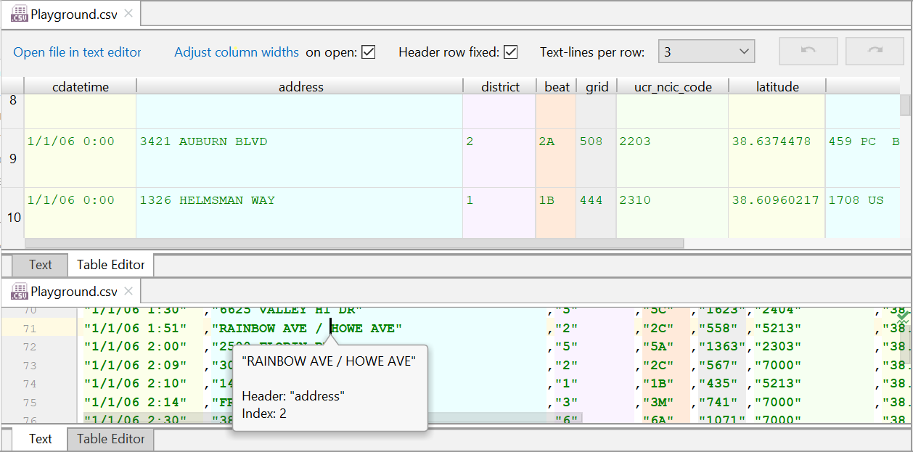
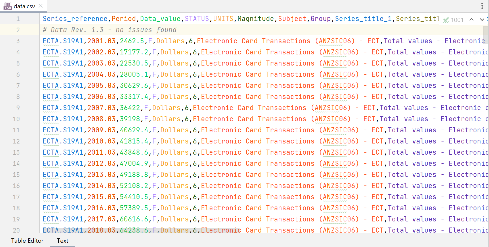
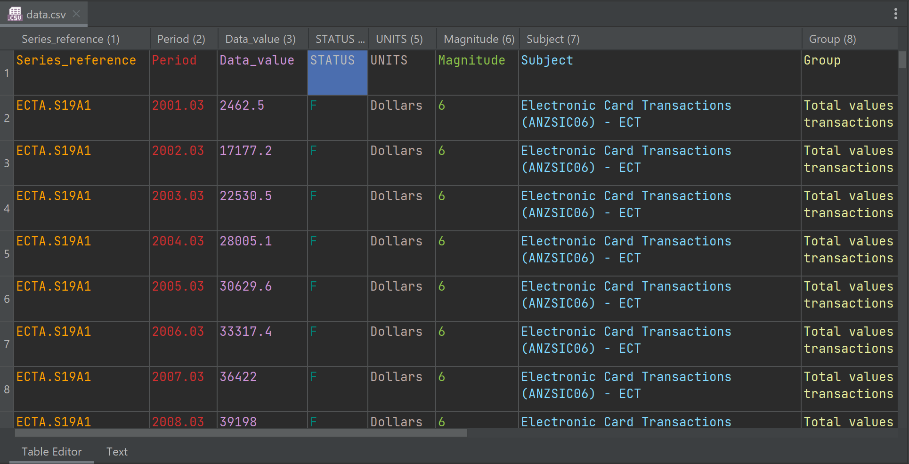
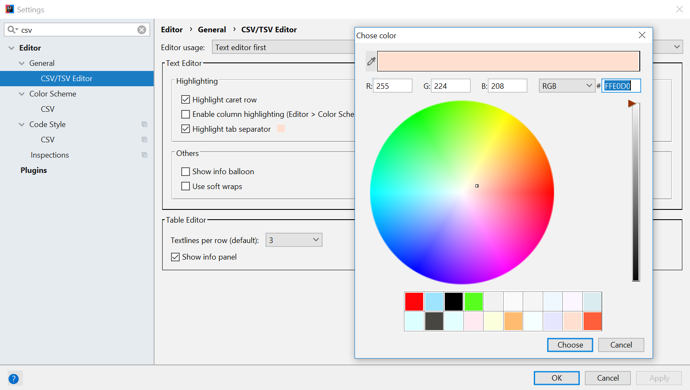
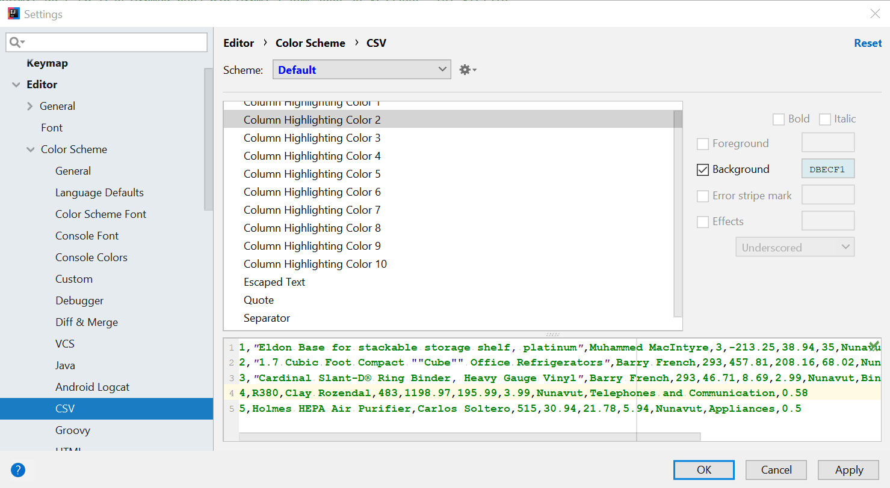
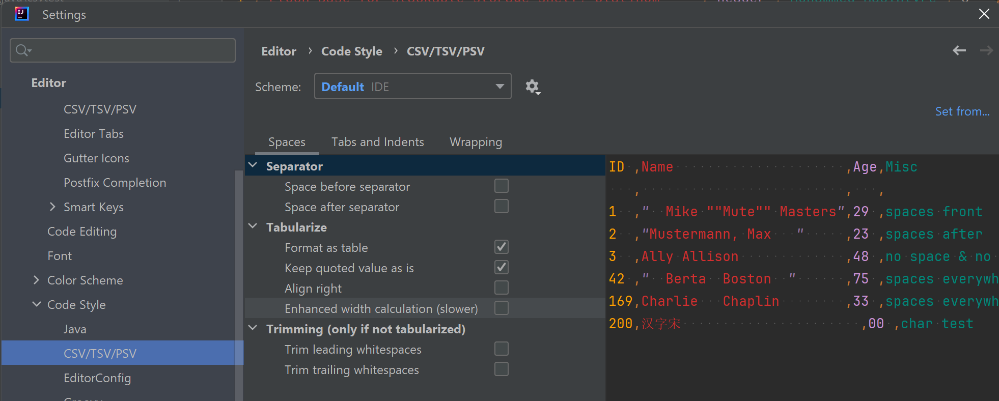
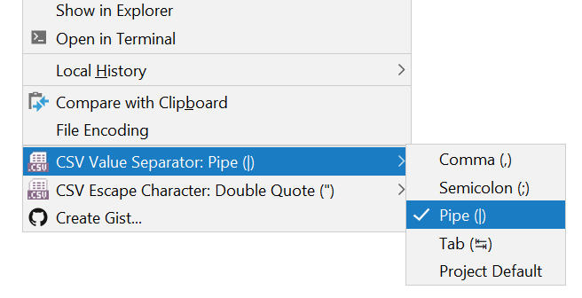

[](https://plugins.jetbrains.com/plugin/10037-csv-plugin)
[](https://github.com/SeeSharpSoft/intellij-csv-validator/actions)
[](https://github.com/SeeSharpSoft/intellij-csv-validator/actions)
[](https://coveralls.io/github/SeeSharpSoft/intellij-csv-validator?branch=main)
[](https://snyk.io/test/github/SeeSharpSoft/intellij-csv-validator?targetFile=build.gradle)
[](https://www.codacy.com/gh/SeeSharpSoft/intellij-csv-validator/dashboard?utm_source=github.com&amp;utm_medium=referral&amp;utm_content=SeeSharpSoft/intellij-csv-validator&amp;utm_campaign=Badge_Grade)

# CSV Editor Plugin for the JetBrains IDE family

Compatible with IntelliJ IDEA and other JetBrains IDEs based on IntelliJ Platform _2025.2 and newer_.

This plugin adds support for CSV (Comma-Separated Values) and related file types to JetBrains IDEs. It provides a text editor and a table editor with syntax validation, highlighting, formatting, inspections, and other familiar IDE features.



## Features

- CSV, TSV, and PSV file detection
- customizable text and table editors
- side-by-side table diffs with cell highlighting, editing, and undoable change application
- customizable column coloring (rainbow coloring)
- syntax validation and highlighting
- code formatting
- quick-fix inspections
- intentions (Alt+Enter), such as Quote/Unquote (all) and Shift Column Left/Right
- spell checking for field values
- an optional information tooltip showing the current value, column header, and column number (quick documentation)
- comma, semicolon, colon, pipe, tab, and record-separator value separators
- custom value separators
- line comments (# by default, customizable)
- tab-separator highlighting

(see [full changelog](./CHANGELOG.md))

**Note**

Release numbers follow `VVV.X.x`: the earliest supported IDE build branch, the plugin's
major version, and its bugfix version. For example, `252.53.0` supports IDEs from 2025.2.
The minimum supported IDE follows the official IntelliJ release cycle with a one-year delay.

Previous versions, including their README files, can still be downloaded and installed manually (see [Installation](https://github.com/SeeSharpSoft/intellij-csv-validator#installation)).

### Validation

The plugin checks CSV files according to the standard defined in [RFC 4180](https://www.ietf.org/rfc/rfc4180.txt), but it tolerates whitespace around quoted values and accepts most literal text. This makes validation less restrictive and keeps the format flexible.

According to the strict standard, the following snippet is invalid because of the whitespace after each comma. The plugin accepts it:

```
"firstName", "lastName", "birthday"
```
Syntax errors are still detected and can be inspected. If a document contains syntax errors, features such as the table editor, code formatting, or structure view may be unavailable or may work with incomplete data until the errors are fixed.



### Separator

CSV files are flexible and can be used for many kinds of data. This has led to several CSV variants, such as semicolon-separated and pipe-separated values, which use a different value separator while keeping the same general format.

The plugin supports file-specific separator settings.
It provides predefined comma (,), semicolon (;), colon (:), tab, pipe (|), and record-separator (RS) values. You can also choose a custom separator.

#### TSV/PSV

A different separator can be chosen for each CSV file.

The file types TSV (Tab-Separated Values) and PSV (Pipe-Separated Values) are supported as CSV variants. TSV files use a tab as their separator, and PSV files use a pipe. They use the same formatter and code-style settings as CSV files, and support the same features, including the table editor, inspections, and intentions. The `.tab` extension is also recognized as TSV.

### Table Editor

The plugin provides a table editor for CSV, TSV, and PSV files as an alternative to the text editor. It has its own features and settings, independent of JetBrains' [_Edit as Table..._](https://www.jetbrains.com/help/phpstorm/editing-csv-and-tsv-files.html) and _Data_ tab.

Switch views using the editor tabs or **Show Text Editor** / **Show Table Editor** buttons. The [selected field is kept by default](#keep-selected-field-when-switching-editors).

**Note:** Files with syntax errors are read-only in the table editor. Fix the errors in the text editor before editing them as a table.



#### Find and Replace

Use the IDE's **Find** and **Replace** shortcuts (Ctrl+F and Ctrl+R in the default Windows/Linux keymap) to search table cells, with case-sensitive, whole-word, and regular-expression options. Matches select and reveal the corresponding cell. **Replace All** is a single undoable edit. Press Escape to close the search bar.

#### Table diffs

The plugin adds a **CSV Table** view alongside the existing text views in the diff viewer
for CSV, TSV, and PSV files. Select it when comparing Git revisions, viewing **Local History**
changes, using **Compare with Clipboard**, or comparing two files with **Compare Files**.

**Note:** The table and text views may report difference counts that differ by one due to how they
handle a newline at the end of a file.

#### Copy and Paste

Use the IDE's usual **Copy** and **Paste** shortcuts for CSV or spreadsheet data. Paste starts at the focused cell and **overwrites existing values** rather than inserting or shifting cells. The table grows only if the pasted data extends beyond its edges.

While editing a cell, paste inserts text into that cell instead of filling multiple cells. A trailing line break in copied data does not create an extra row. You can undo the entire paste in one step.

Comment lines must be pasted into the first column and replace whole rows. Pasting multiple values into a comment row is not supported.

#### Context menu

A right-click within the table or on its row numbers opens a context menu for adding or removing rows. Right-click the table header to add or remove columns.

The actions in these menus apply to the currently selected rows or columns, which may differ from the cell or header where the context menu appears. A right-click does not change the selection by default.

#### Moving rows and columns

Drag column headers or the middle of row numbers to reorder columns or rows. Their context menus also offer **Move Selected Rows Up/Down** and **Move Selected Columns Left/Right**. Dragging a row number's bottom edge resizes the row instead.

Use Ctrl/Cmd-click or Shift-click to select multiple headers, then drag any selected header to move the selection as one block. Non-adjacent selections keep their original order and become adjacent at the drop position. A click without dragging selects a single row or column.

Moves change the file, not just the display order, and support Undo/Redo. Read-only files and files with syntax errors cannot be reordered; the empty row for a final line break cannot be moved. Large moves show a progress dialog; cancelling during preparation leaves the file unchanged.

#### Row-number column width

Drag the right edge of the blank header above the row numbers to resize the row-number column. Its width is saved for each file and does not change the data-column widths. Until you resize it, the row-number column automatically fits the visible row numbers.

#### Frozen columns

Select a column header, then right-click the header and choose **Freeze Columns Through Selection** to keep that column and all columns to its left visible while scrolling horizontally. If multiple columns are selected, the rightmost selected column determines the frozen area. Choose **Unfreeze Columns** in the same menu to restore normal scrolling.

A distinct divider after the last frozen column marks the frozen area in both the header and table. Frozen columns remain editable and support the same selection, resizing, and Find/Replace controls as other columns. The frozen-column count is saved for each file.

#### Key bindings

Configure table commands in **Settings/Preferences > Keymap > CSV Table Editor** (or search for the action name). You can add, remove, or reassign shortcuts using the IDE's standard keymap controls, including two-stroke shortcuts. Changes take effect in already-open table editors. The context menus show the current shortcuts, not fixed default labels.

The following are the default shortcuts. Ordinary arrow-key and Enter-based cell navigation remain table controls rather than configurable CSV actions:

- **_ARROW KEYS_** navigate through the table
- **_ENTER_** start/stop editing current cell (NOTE: almost every default key triggers an edit)
- **_CTRL+ENTER_** actual Enter key while editing a cell
- **_SHIFT+ENTER_** stop editing and move to previous row
- **_CTRL+SHIFT+ENTER_** stop editing and move to next row

- **_CTRL+SHIFT+LEFT_** adds a new column before the current cell
- **_CTRL+SHIFT+RIGHT_** adds a new column after the current cell
- **_CTRL+SHIFT+DELETE/BACKSPACE_** deletes the current selected column(s)

- **_CTRL+UP_** adds a new row before the current cell
- **_CTRL+DOWN_** adds a new row after the current cell
- **_CTRL+DELETE/BACKSPACE_** deletes the current selected row(s)

- **_DELETE/BACKSPACE_** clear content of selected cell(s)
- **_CTRL+SHIFT+SPACE_** auto-fit column widths

The unmodified Delete/Backspace shortcuts edit text normally while a cell's text editor is open; they clear selected cells only outside cell-editing mode. Other table commands, such as moving rows/columns, freezing columns, and resetting column widths, can also be assigned shortcuts in Keymap.

Hold **_CTRL_** while using the mouse wheel to change the table text size. Hold **_SHIFT_** while using the mouse wheel to scroll horizontally.

### Editor Settings

- _Settings/Preferences > Editor > General > CSV/TSV Editor_

The plugin provides a customizable text editor and table editor. Their settings can be adjusted in the CSV/TSV editor settings page.

Changes to Text Editor and Table Editor settings do not update already-open editors. Close and reopen the affected files for changes to take effect.



#### General

##### Editor Usage

You can choose **Text Editor first**, **Table Editor first**, or **Text Editor only**. This controls the order of the editor tabs and whether the table editor is shown. A **Table Editor only** option is not available because the table editor cannot edit files with syntax errors.

##### Hide editors of other plugins

Some plugins, such as [Big Data Tools](https://plugins.jetbrains.com/plugin/12494-big-data-tools), provide their own editors for CSV and TSV files and hide all other editors, including the CSV text and table editors. Enable this option to keep the CSV text and table editors available: they are shown first, ordered according to [Editor Usage](#editor-usage), followed by editors of other plugins that hide all other editors as well. Editors of other plugins that do not hide other editors are not shown. This option is **disabled by default** to keep the editors of other plugins as they are. Close and reopen files that are already open for the change to take effect.

##### Keep selected field when switching editors

When switching between the text editor and the table editor, the newly shown editor selects the field that was selected in the other one (see [Table Editor](#table-editor)). This option is **enabled by default**. Disable it to keep independent positions in both editors, e.g. to preserve a multi-cell table selection or multiple text carets while checking something in the other editor. Changes apply to already-open editors.

##### Default Value Separator (CSV only)

The predefined separators are **,** (comma), **;** (semicolon), **:** (colon), **|** (pipe), tab, and the record separator. A custom separator can also be entered; it must contain at least one character and no spaces.

_Default Value Separator_ defines the separator used for newly created or opened CSV files. You can change the separator for an individual file from the editor's context menu.

###### Auto Detect

The separator of a newly opened CSV file can be detected automatically by comparing the occurrences of predefined separators.

If _Auto Detect_ is enabled (the default), _Default Value Separator_ is used for newly created files and for existing files where no separator can be detected. Otherwise, existing files use the separator detected in their content.

**Note:** This option has no effect on TSV/PSV files, the separator is pre-defined by their file- and language-type.

##### Default Escape Character

The following escape characters are supported: **"** (double quote) and **\\** (backslash).

Within a quoted value, the escape character marks a double quote as part of the value instead of the closing quote.

_Default Escape Character_ defines the escape character used for newly opened CSV, TSV, and PSV files. You can change it for an individual file from the editor's context menu.

##### Line Comment Indicator

Define the character or characters used to mark a line as a comment in a CSV document. The default indicator is **#**.

##### Column numbering

Enable zero-based column numbering. This affects the information tooltip in the text editor and the column numbering in the table editor.

##### Value coloring

Choose the coloring method of values. Possible options are:

- _Rainbow (Column Color)_ - values are colored according to their column.
- _Simple (Text Color)_ - values use the configured text color.

All colors can be adjusted via [CSV Color Scheme](#color-scheme) settings.

#### Text Editor

##### Highlighting

###### Highlight caret row

The current caret row can be highlighted in CSV, TSV, and PSV files. Disable this option if it interferes with custom background colors.

###### Highlight tab separator

Enable or disable highlighting of tab characters when they are used as the value separator in TSV files, and choose the highlight color. Tabs inside a value are not highlighted. This option is independent of **Show info balloon**.

###### Highlight active column

**Highlight active column** under **Settings/Preferences > Editor > General > CSV/TSV/PSV > Text Editor > Highlighting** highlights fields in the selected column. This option is **enabled by default**. Column highlights use the color scheme's write-access-under-caret style, distinct from normal selected-text occurrences, and are cleared while Find or Replace is open. The IDE's selected-text occurrence highlighting remains controlled by its own settings.

Set **Maximum rows** beside the checkbox to **-1** (the default) for no limit, **0** for no highlighted rows, or a positive integer to limit highlighting to nearby CSV rows, including the selected row. Other negative values are not allowed. Multiline values count as one CSV row. Highlighting more rows can reduce editor responsiveness. Close and reopen the editor after changing its settings.

##### Others

###### Show info balloon

Enable or disable the field information in the text editor. It shows the current value, its header, and its column number when hovering over a value (if the IDE's **Show quick documentation on hover** option is enabled) or via **Quick Documentation** (Ctrl+Q / F1). The information is computed only for the requested value, so it remains cheap for large files.

###### Use soft wraps

Choose whether soft wrapping is enabled for CSV, TSV, and PSV files. You can still change this for an individual file by right-clicking the editor's left margin.

###### Keep trailing whitespaces

If enabled, trailing whitespace is always preserved when editing CSV, TSV, and PSV files, regardless of the general editor setting.

**Note:** This setting has no effect on the table editor. Unquoted values are trimmed when the table editor opens them. When a value is edited in the table editor, leading or trailing whitespace causes the value to be quoted.

#### Table Editor

The table editor uses Swing components with padded cells, a flat header, and rounded scrollbars. It follows the IDE's light or dark appearance without changing the IDE theme.

##### Default row height

The default and initial height of each table row in pixels.

##### Default column width

The default and initial width of a table column in pixels.

##### Maximum column width

The maximum width of a table column in pixels when column widths are adjusted automatically. Set it to **0** to remove the limit. This setting has no effect when you resize columns manually.

##### Keep or ignore the line break at the end of a file

If the file ends with a completely empty line (without spaces or tabs), the table editor ignores that line instead of displaying it as empty values. When the file is saved, the existing empty line is retained at the end.

##### Enforce value quoting

When a value is created or edited in the table editor, always quote it, even when quoting is not required.

Without this setting, editing or replacing a value in the table editor keeps its quotes if it was quoted before, while other values are quoted only when required.

### Color Scheme

CSV elements such as separators (for example commas, pipes, and semicolons), quote characters, escaped text, comments, and values are colored according to the CSV color scheme settings:

- _Settings/Preferences > Editor > Color Scheme > CSV/TSV/PSV_

The preset colors follow JetBrains IDE defaults and support different UI themes.



#### Column Colors

In addition to colors and font styles for the different CSV elements, you can define 10 column colors for rainbow coloring. These colors are used when **Rainbow** is selected as the [**Value Coloring**](#value-coloring) option in the [Editor Settings](#editor-settings).

### Formatting

- _Settings/Preferences > Editor > Code Style > CSV_



#### Spaces

Formatting CSV requires care because whitespace can be part of a value. The formatter can add spaces around separators, align values as a table, or trim whitespace according to your settings. Formatting can be disabled by clearing all formatting options.

Apply formatting to CSV documents as you would to code:

- _Code > Reformat code (Ctrl+Alt+L)_

The following examples use this CSV snippet as input:

```
"name", "city", "position"
Annasusanna,Amsterdam,1
  Ben  ,  Berlin  , 2
```

##### Separator

Adjust spacing around the separator.

_Space before separator_

```
"name" , "city" , "position"
Annasusanna ,Amsterdam ,1
  Ben ,  Berlin , 2
```

_Space after separator_

```
"name", "city", "position"
Annasusanna, Amsterdam, 1
  Ben  , Berlin  , 2
```

##### Tabularize

Separator settings can be used together with `Format as table`. Trimming options do not apply when `Format as table` is enabled.

_Format as table_

Adds or removes leading and trailing whitespace to format the text as a readable table.

**Note:** Formatting a CSV file changes its values and can conflict with the visual table editor.

```
"name     ","city   ","position"
Annasusanna,Amsterdam,1
Ben        ,Berlin   ,2
```

_Keep quoted value as is_

**Note:** With this option, quoted values are kept intact. Enabling `Enforce value quoting` for the table editor can make it easier to edit and format a CSV file in either editor.

```
"name"     ,"city"   ,"position"
Annasusanna,Amsterdam,1
Ben        ,Berlin   ,2
```

_Align right_

```
"     name","   city","position"
Annasusanna,Amsterdam,         1
        Ben,   Berlin,         2
```

_Enhanced width calculation_

Calculates text width based on the width of its characters and takes wide characters into account. This can noticeably affect performance on large files.

```
"name     ","city   ","position"
Annasusanna,Amsterdam,1
汉字宋      ,Berlin   ,2
```

##### Trimming

Trimming can be combined with _Space before separator_ and _Space after separator_.

_Trim leading whitespaces_

```
"name","city","position"
Annasusanna,Amsterdam,1
Ben  ,Berlin  ,2
```

_Trim trailing whitespaces_

```
"name", "city", "position"
Annasusanna,Amsterdam,1
  Ben,  Berlin, 2
```

### Actions

#### File-specific value separator and escape character



The editor's context menu lets you change the value separator or escape character used to interpret a specific file. A custom value separator can also be entered.

**Note:** This changes how the plugin interprets, validates, and highlights the file; it does not change the file's content. Existing separators and escaped values are not replaced or rewritten.

#### Auto-fit column widths (table editor only)

Calculates and sets a width for each table column based on its content. The maximum column width can be changed in the [Editor Settings](#maximum-column-width).

#### Reset column widths to default (table editor only)

Sets all table columns back to their default width. The default column width can be changed in the [Editor Settings](#default-column-width).

### Inspections

- _Settings/Preferences > Editor > Inspections > CSV_

Inspections help you fix syntax errors. Press _Alt+Enter_ when the cursor is at an error. The plugin provides three types of inspections:

- **Surround with quotes** - surrounds the current field with quotes and escapes existing quote characters.
- **Add separator** - adds a missing separator at the cursor position.
- **Add closing quote** - adds a missing closing quote at the end of the document.

### Intentions

- _Settings/Preferences > Editor > Intentions > CSV_

Intentions provide quick ways to adjust the document. Press _Alt+Enter_ to see the intentions available at the current cursor position.
The plugin provides six types of intentions:

- **Quote All** - surrounds all unquoted fields with quotes.
- **Quote Value** - quotes the unquoted value at the cursor position.
- **Unquote All** - removes quotes from quoted fields where possible.
- **Unquote Value** - removes quotes from the quoted value at the cursor position where possible.
- **Shift Column Left** - moves the column at the cursor position one position to the left.
- **Shift Column Right** - moves the column at the cursor position one position to the right.

## Installation

Install the plugin from the JetBrains Marketplace in your IDE (**recommended**):

- _Settings/Preferences > Plugins > Marketplace_ - search for **CSV Editor**.

You can also download the plugin package from the [JetBrains Marketplace](https://plugins.jetbrains.com/plugin/10037-csv-plugin) or from [GitHub Releases](https://github.com/SeeSharpSoft/intellij-csv-validator/releases) and install it manually:

- _Settings/Preferences > Plugins > gear icon > Install Plugin from Disk..._

## Troubleshooting

#### The CSV editor does not seem to work

Make sure the file is assigned to the plugin's file type in _Settings/Preferences > Editor > File Types_. The plugin recognizes **.csv**, **.tsv**, **.tab**, and **.psv** files.

#### CSV editor features are not available

If another CSV plugin, such as [Rainbow CSV](https://plugins.jetbrains.com/plugin/12896-rainbow-csv), is enabled, the IDE may assign the file to that plugin instead. Check the file type mapping in _Settings/Preferences > Editor > File Types_ and disable the competing plugin for the affected file type if necessary.

Some plugins, such as [Big Data Tools](https://plugins.jetbrains.com/plugin/12494-big-data-tools), hide all other editors for CSV/TSV files. If the CSV text and table editors are missing, enable [**Hide editors of other plugins**](#hide-editors-of-other-plugins) under _Settings/Preferences > Editor > General > CSV/TSV Editor > General_. This setting is **disabled by default**; enabling it keeps the CSV text and table editors available and places them first according to [Editor Usage](#editor-usage). Close and reopen the affected files for the change to take effect ([#937](https://github.com/SeeSharpSoft/intellij-csv-validator/issues/937)).

If the **Table Editor** tab or the **Show Table Editor** button is missing, check the [table editor](#table-editor) settings and make sure **Text Editor only** is not selected. The table editor is also unavailable for files the IDE cannot load because they exceed the configured file-size limits.

#### The CSV editor causes the IDE to stop working properly

The current plugin release requires IntelliJ Platform 2025.2 or newer. If your IDE is older, disable the plugin and install a plugin release compatible with your IDE from [GitHub Releases](https://github.com/SeeSharpSoft/intellij-csv-validator/releases).

#### Code insight is not available for large files

The IntelliJ Platform disables code insight for files larger than its configured limit. To change this limit, open _Help > Edit Custom Properties_ and add or update the following property, using a value in bytes:

`idea.max.intellisense.filesize=<maximum-file-size-in-bytes>`

Restart the IDE after changing the property.

## Contribution

Contributions are welcome. Please check [CONTRIBUTING.md](./CONTRIBUTING.md) for more information.

Besides source code contributions, feel free to open bug reports or just suggest new features [here](https://github.com/SeeSharpSoft/intellij-csv-validator/issues).

### Code/feature contributors

- zoom table-editor cells with Ctrl+Mouse Wheel @royqh1979

## JetBrains Repository

[JetBrains Plugin Repository](https://plugins.jetbrains.com/plugin/10037-csv-plugin)
